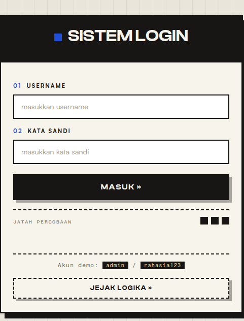
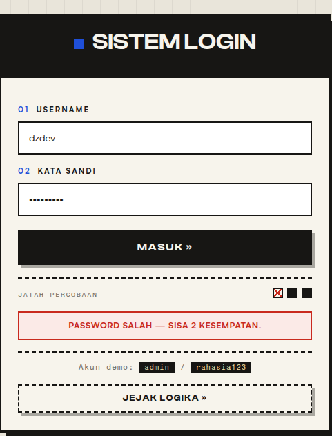
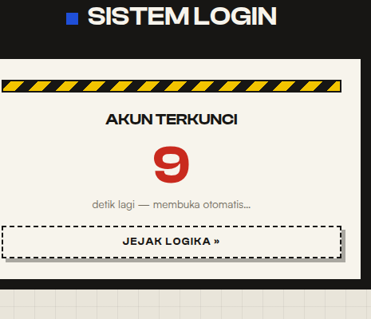
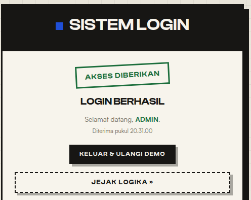
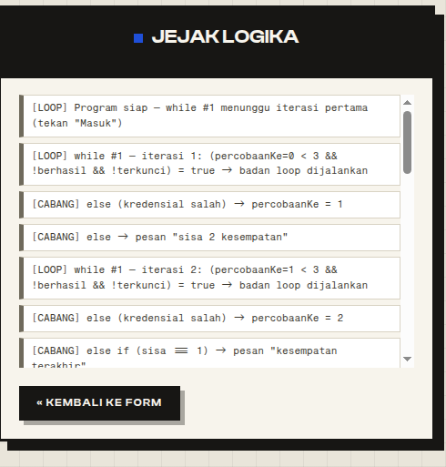

# Sistem Login - 3x Salah Langsung Terkunci

Adesta Eka Saputra
NIM 25533955 · Kelas E3, Informatika

Tugas web: bikin program HTML + CSS + JS murni, di dalamnya harus ada
percabangan dan perulangan, terus dua-duanya mesti berkesinambungan. Saya
ambil kasus form login karena paling gampang dibayangin. Salah password 3
kali, akunnya kekunci 10 detik, abis itu kebuka sendiri.

## Tampilannya

Form loginnya kayak gini:



Kalau password salah, jatah percobaannya berkurang. Sisa 2:



Sisa 1, kartunya sampai bergetar:


Salah yang ketiga akunnya kekunci, ada countdown 10 detik:



Kalau masuk pakai akun yang bener:



Terakhir panel Jejak Logika, penjelasannya di bawah:



## Cara jalanin

Paling gampang double-click `index.html`.

Kalau mau lewat server (biar sama kayak pas demo):

```bash
python3 -m http.server 8765
```

Terus buka http://localhost:8765. Kalau mau dibuka dari HP yang WiFi-nya
sama, tambahin `--bind 0.0.0.0`, nanti buka pakai IP laptopnya.

Akun demonya `admin` / `rahasia123`.

Font (Clash Display, Satoshi, Fragment Mono) saya taruh di folder `fonts/`,
jadi tampilannya tetap sama walau nggak ada internet.

## Logikanya di mana

Perulangan utamanya sebenernya `while` kayak gini:

```
while (percobaanKe < 3 && !sudahBerhasil && !terkunci) {
    ...
}
```

Tapi karena programnya jalan di browser, `while`-nya nggak ditulis literal.
Satu kali tombol Masuk ditekan = satu iterasi. Jadi tiap submit, saya cek
dulu kondisinya masih `true` atau nggak. Kalau udah `false` ya berhenti.

Di dalam satu iterasi itu ada cabangnya:

- input kosong → kasih peringatan, jatahnya nggak hangus
- username & password benar → `sudahBerhasil = true`
- selain itu → `percobaanKe` ditambah, terus dicek sisanya berapa

Nah di sini nyambungnya. Hasil cabang ngubah nilai `percobaanKe` dan
`sudahBerhasil`, dan nilai itu yang dibaca lagi sama kondisi `while` di
iterasi berikutnya. Jadi cabangnya yang nentuin kapan loop-nya berhenti.

Selain itu ada dua perulangan lagi: countdown 10 detik pas terkunci pakai
`setInterval` (prinsipnya sama kayak `while (detik > 0)`), sama gambar titik
jatah percobaan pakai `for`.

## Panel Jejak Logika

Tombol **Jejak Logika** di bawah form buat buka panel ini. Isinya rekaman
langkah program dari awal, tiap iterasi loop, tiap cabang yang diambil,
dan efeknya ke kondisi loop. Ada tiga warna tag:

- `[LOOP]`: perulangan lagi jalan
- `[CABANG]`: percabangan lagi ambil keputusan
- `[HASIL]`: efek keputusan itu ke kondisi loop

Yang mau saya tunjukin dari panel ini: begitu jatah salah habis, variabel
`terkunci` jadi `true`, kondisi `while` jadi `false`, loop berhenti. Dari
situ kelihatan kalau percabangan dan perulangannya beneran nyambung, bukan
dua hal yang cuma ditempel jadi satu.

## Isi file

- `index.html`: struktur halaman (login, sukses, terkunci, panel log)
- `style.css`: semua styling
- `script.js`: logika percabangan dan perulangannya, hampir tiap blok saya kasih komentar biar gampang dijelasin pas presentasi
- `fonts/`: file font biar tetap jalan offline
- `screenshot/`: gambar buat README
